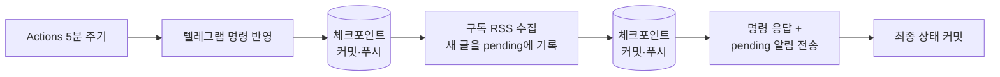

# rss-telegram-bot

RSS를 지원하는 사이트에 새 글이 올라오면 텔레그램 봇(`@rss_pinger_bot`)으로 알려주는 봇. 별도 서버 없이 GitHub Actions만으로 동작하며, 구독 목록은 텔레그램에서 직접 추가·수정·삭제·조회합니다.

기본으로 [GeekNews](https://news.hada.io)(`https://news.hada.io/rss/news`)를 구독합니다.

## 텔레그램 명령

| 명령 | 설명 |
|---|---|
| `/list` | 구독 중인 RSS 목록 |
| `/add <URL> [이름]` | RSS 추가. 이름을 생략하면 피드 제목 사용 |
| `/edit <번호> name <새 이름>` | 이름 변경 |
| `/edit <번호> url <새 URL>` | 주소 변경 |
| `/remove <번호>` | 구독 삭제 |
| `/help` | 사용법 |

`/add` 시점의 기존 글은 알리지 않고, 그 이후에 올라온 글부터 알립니다.

구독 번호는 `/list` 기준이며 삭제하면 뒤의 번호가 당겨지므로, `/edit`·`/remove`는 보내기 전에 `/list`로 확인하세요. 응답에는 대상 구독의 이름과 이전 값(주소)이 함께 나와 잘못 적용됐는지 알 수 있고, 주소를 바꿔도 아직 알리지 못한 알림은 지우지 않고 그대로 전달합니다. 같은 주소로 `/edit`하면 아무것도 바꾸지 않습니다.

`/edit url`로 주소를 바꾸면 기준선은 그 자리에서 덮지 않고 **다음 수집 때** 판단합니다. 새 주소의 글이 기존 기록과 하나라도 겹치면 같은 피드(`http`→`https`, 끝 슬래시, 미러 등)라서 새 글을 그대로 알리고, 하나도 겹치지 않으면 다른 피드라서 기존 글은 알리지 않고 이후 글부터 알립니다. 같은 피드인지 판단하거나 이미 본 글인지 비교할 때는 **정확히 같은 ID**만 확실히 본 글로 봅니다. `http`↔`https`, `www.`, 호스트 대소문자, 경로 끝 슬래시만 다른 ID(미러·주소 이전)는 근사 일치로 보되, 기존 기록과 새 피드 **양쪽에서 그 형태가 하나뿐인 1:1 짝일 때만** 같은 글로 인정합니다. 같은 형태의 ID가 여럿이라 모호하면 합치지 않고 알립니다. 어떤 정규화 규칙을 써도 서로 다른 글이 합쳐질 가능성은 남고, 합쳐지면 새 글이 사라지므로 중복 알림은 감수하고 누락은 피하는 쪽을 택했습니다. 정규화는 URL 형태의 ID에만 적용하며 경로·쿼리의 대소문자, 쿼리·`#` 값의 끝 슬래시, `tag:`·`urn:`·`yt:video:` 같은 비 URL ID와 상대 경로는 바꾸지 않습니다. (다른 피드로 바꿨다가 이전 주소로 돌아오면 그 사이 올라온 글은 알리지 않습니다.)

글이 하나도 없는 응답은 기준선으로 삼지 않습니다. 장애로 잠깐 비어 보이는 것일 수 있고, 빈 기준선을 잡으면 복구된 뒤 기존 글이 전부 새 글로 발송되기 때문입니다. 그래서 `/add`·`/edit url`은 글이 없는 피드를 거부하고, 수집 중 빈 응답을 받으면 기준선과 주소 변경 판단을 글이 보일 때까지 미룹니다. 기존 기록이 있는 피드가 일시적으로 비어 응답해도 기록은 그대로 유지됩니다.

## 동작 방식



- RSS는 푸시가 아니라 폴링이므로, 워크플로(`.github/workflows/poll.yml`)가 5분마다 실행되어 명령 처리와 새 글 확인을 한 번에 합니다.
- 명령 응답과 알림은 실행 시점에 이루어지므로 **최대 수 분 지연**될 수 있습니다. GitHub Actions의 cron은 부하에 따라 더 늦게 시작되기도 합니다.
- 구독 목록은 `data/feeds.json`, 확인한 글 ID·미전송 글(pending)·텔레그램 offset은 `data/state.json`에 저장되고 변경분이 커밋됩니다.

### 알림이 유실되지 않는 방식

- **전송 전에 먼저 커밋(write-ahead)**: 새 글을 pending에 기록해 저장소에 커밋·푸시한 **뒤에** 전송합니다. 전송 도중 러너가 강제 종료돼도 글은 저장소에 남아 다음 실행에서 재전송됩니다. 이때 이미 보낸 글이 한 번 더 갈 수는 있지만(at-least-once) 빠지지는 않습니다.
- **명령도 먼저 확정**: 텔레그램 명령의 결과와 offset을 응답 전송 전에 커밋하므로 같은 명령이 두 번 실행되지 않습니다. 저장소에 기록하지 못했더라도 응답은 보냅니다.
- **응답도 보관**: 명령 응답과 경고 메시지는 `data/state.json`의 `outbox`에 먼저 기록되고, 전송에 성공해야 지워집니다. 텔레그램이 불통이어도 다음 실행에서 다시 보냅니다. (최대 50건)
- **전송과 수집 분리**: 피드가 장애 중이어도 이미 저장된 pending 알림은 계속 재전송합니다. 피드는 동시에(피드마다 전용 스레드) 가져오고 수집 단계에 150초 한도를 두어, 응답 없는 피드가 많아도 체크포인트와 전송 시간을 잡아먹지 않습니다. 같은 호스트로는 동시에 2개까지만 요청해, 한 사이트의 피드 여러 개나 feedburner 같은 공용 호스트에서 429·차단을 맞아 정상 피드가 누락되는 일을 막습니다. (다른 호스트끼리는 제한 없이 동시에 진행)
- **시간 한도**: 피드 한 건은 본문 수신 전체 30초, 텔레그램 명령 처리 120초, 수집 150초, 전송 300초로 한도를 둬서, 느린 서버나 오래 걸리는 명령이 있어도 최종 커밋까지 실행 제한(10분) 안에 도달합니다. 한도로 못 끝낸 명령과 알림은 다음 실행으로 넘깁니다.
- **전체 시간 한도**: 위 단계별 한도는 `SIGALRM`으로 강제하는 실행 전체 한도(420초)가 받쳐 줍니다. 진행 중인 요청이 블로킹돼 있어도 끊고, 상태를 저장한 뒤 실패로 끝내며, 체크포인트의 git 자식 프로세스도 함께 종료합니다. 남은 시간(체크아웃과 최종 커밋 단계, 최대 3분)으로 실행 제한 10분 안에 최종 상태 커밋까지 도달합니다.
- **시간 한도와 상태 일관성**: 실행 전체 한도 신호는 어느 줄에서든 도달할 수 있어서, 상태를 여러 군데 고치는 구간(명령의 offset·적용·응답 적재, 피드별 `seen`·`pending` 갱신)에서는 신호를 보류했다가 구간이 끝난 뒤에 전달합니다. 반쯤 바뀐 상태가 저장돼 글이나 명령이 사라지는 일을 막기 위함입니다. 이 구간에는 네트워크 호출이 없습니다. `/add`·`/edit url`의 피드 검증은 상태를 바꾸기 전에 먼저 수행해, 검증이 오래 걸려도 전체 한도로 끊을 수 있습니다. (끊기면 명령은 다음 실행에서 다시 처리)
- **글 ID 정리**: 중복 확인용 글 ID(guid, permalink)도 공개 상태 파일에 기록되므로, 인증 정보로 보이는 값이 들어 있으면 내용 해시(`sha1:…`)로 대체합니다. 절대 URL뿐 아니라 상대 경로(`/post?token=…`), 스킴 없는 주소(`//host/p?sig=…`), `key=value` 꼴도 검사합니다. 그렇지 않은 ID는 그대로 둬서 이미 기록된 ID와 일치를 유지합니다.
- **링크 정리**: 대기 글은 전송 전에 공개 저장소에 기록되므로, 글 링크에서 `utm_*`와 `token`·`sig`·`key` 같은 인증 정보로 보이는 파라미터(`;`로 구분된 것 포함), 아이디·비밀번호(userinfo), 모든 경로 조각의 `;...`(세션 ID 등), fragment(`#...`)를 지웁니다.
- **최신 상태로 시작**: 워크플로가 큐에서 대기하다 시작해도 앞선 실행의 최종 커밋이 빠진 오래된 SHA를 읽지 않도록, 시작 시점의 브랜치 최신 커밋을 체크아웃합니다.
- **원격 변경 보존**: 체크포인트의 rebase로 병합돼 온 원격 변경(예: 손으로 고친 구독 이름)은 바로 다시 읽어 들여, 이후 저장이 되돌리지 않습니다.
- **명령은 나눠서 처리**: 한 번에 최대 25개씩 처리하고 응답 보관함(`outbox`)이 가득 차면 새 명령을 가져오지 않아, 몰린 명령의 응답이 한도 때문에 버려지지 않습니다.
- 전송에 실패한 글은 제목·링크째 pending에 보관되어, 피드에서 글이 사라져도 알림이 누락되지 않습니다. 텔레그램 자체가 불통이면 첫 실패에서 중단하고 다음 실행에 재시도합니다.
- 텔레그램이 메시지 자체를 거부(HTTP 400)하면 평문으로 한 번 더 보내고, 그래도 거부되면 그 글만 건너뜁니다.
- 처음 보는 피드는 기준선만 잡고 알리지 않습니다. 대기 글은 **오래된 글부터 한 번에 피드당 10건씩** 보내고 나머지는 다음 실행에서 이어서 보냅니다. (최신 글만 보내고 오래된 글을 건너뛰면, 주소 변경 뒤의 중복 알림처럼 새로 쌓인 글이 발송 자리를 채워 먼저 대기하던 진짜 미전송 알림이 사라집니다.) pending은 피드당 100건까지 보관합니다. 한도를 넘는 새 글은 앞쪽의 오래된 글을 잘라 내며 밀어 넣지 않고, 대기열에도 `seen`에도 넣지 않은 채 다음 실행으로 **미룹니다**. 전송이 진행돼 자리가 나면 피드에 남아 있는 한 다시 새 글로 잡혀 순서대로 전달됩니다. 다만 미뤄진 글이 전송이 정상화되기 전에 피드에서 밀려나면 알릴 방법이 없으므로, 미루기 시작할 때 한 번 경고하고 밀려나 놓친 건수는 텔레그램으로 안내합니다. 이 안내는 발송함(`outbox`)이 가득 차 있어도 사라지지 않도록 건수를 상태(`lost`)에 먼저 기록해 두었다가, 발송함에 자리가 날 때 내보냅니다. 실행 맨 앞에서 새 명령 응답보다 먼저 자리를 얻으므로, 명령이 계속 들어와도 이 안내가 뒤로 밀리지 않습니다. (손실을 막을 수는 없어도 조용히 사라지지는 않게 합니다.) (주소 변경 뒤의 중복 알림 같은 새 글이 먼저 대기하던 미전송 알림을 밀어내지 못하게 하기 위함입니다.)
- 피드 확인이 12회 연속 실패하면 텔레그램으로 한 번 경고합니다.
- 지정한 채팅(`TELEGRAM_CHAT_ID`)의 메시지만 처리하고, 그 외 채팅은 무시합니다.
- RSS 2.0, RSS 1.0(RDF), Atom을 지원하며 외부 의존성 없이 Python 표준 라이브러리만 사용합니다.

> 저장소가 공개이므로 `data/feeds.json`의 구독 목록과 `data/state.json`의 미전송 글 제목·응답 메시지도 공개됩니다. 그래서 `/add`·`/edit url`은 아이디·비밀번호나 `token`, `key`, `secret` 같은 인증 정보로 보이는 URL을 거부하고, 오류 응답에서는 URL을 지웁니다. 구독 목록을 숨기고 싶다면 저장소를 비공개로 전환하세요.

## 설정

1. [@BotFather](https://t.me/BotFather)로 봇을 만들고 토큰을 발급
2. 저장소 Settings → Secrets and variables → Actions에 등록
   - `TELEGRAM_BOT_TOKEN`: 봇 토큰
   - `TELEGRAM_CHAT_ID`: 알림을 받을 채팅 ID (본인 ID를 모르면 [@userinfobot](https://t.me/userinfobot) 등으로 확인)
3. 봇과의 대화에서 `/start`를 한 번 보냄 (사용자가 먼저 말을 걸어야 봇이 메시지를 보낼 수 있음)
4. Actions 탭에서 `poll` 워크플로를 수동 실행(`Run workflow`)해 확인

## 로컬 개발

```sh
python3 -m unittest discover          # 테스트 (Python 3.9+)
TELEGRAM_BOT_TOKEN=... TELEGRAM_CHAT_ID=... DATA_DIR=/tmp/rss-data python3 -m rssbot
# 체크포인트(저장소 커밋)까지 쓰려면 RSSBOT_CHECKPOINT_CMD="bash scripts/commit-state.sh" 를 지정.
# 로컬에서 직접 진행 중인 rebase가 있으면 스크립트는 건드리지 않고 실패합니다. (CI에서만 남은 rebase를 정리)
# 이때 DATA_DIR은 저장소 안의 하위 디렉터리여야 하며(기본 data), 저장소 밖이면 스크립트가 실패로 처리합니다.
```

## 참고

- 공개 저장소에서 60일간 저장소 활동이 없으면 GitHub가 예약 실행을 중지시킵니다. 상태 커밋이 새 글마다 생기므로 보통은 문제가 없지만, 알림이 끊기면 Actions 탭에서 워크플로를 다시 활성화하세요.
