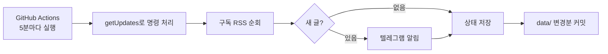

# rss-telegram-bot

RSS를 지원하는 사이트에 새 글이 올라오면 텔레그램 봇(`@rss_pinger_bot`)으로 알려주는 봇. 별도 서버 없이 GitHub Actions만으로 동작하며, 구독 목록은 텔레그램에서 직접 추가·수정·삭제·조회합니다.

기본으로 [GeekNews](https://news.hada.io)(`https://news.hada.io/rss/news`)를 구독합니다.

## 텔레그램 명령

| 명령 | 설명 |
|---|---|
| `/list` | 구독 중인 RSS 목록 |
| `/add <URL> [이름]` | RSS 추가. 이름을 생략하면 피드 제목 사용 |
| `/edit <번호> name <새 이름>` | 이름 변경 |
| `/edit <번호> url <새 URL>` | 주소 변경 |
| `/remove <번호>` | 구독 삭제 |
| `/help` | 사용법 |

`/add` 시점의 기존 글은 알리지 않고, 그 이후에 올라온 글부터 알립니다.

## 동작 방식



- RSS는 푸시가 아니라 폴링이므로, 워크플로(`.github/workflows/poll.yml`)가 5분마다 실행되어 명령 처리와 새 글 확인을 한 번에 합니다.
- 명령 응답과 알림은 실행 시점에 이루어지므로 **최대 수 분 지연**될 수 있습니다. GitHub Actions의 cron은 부하에 따라 더 늦게 시작되기도 합니다.
- 구독 목록은 `data/feeds.json`, 확인한 글 ID와 텔레그램 offset은 `data/state.json`에 저장되고 실행마다 변경분이 커밋됩니다.
- 처음 보는 피드는 기준선만 잡고 알리지 않으며, 한 번에 새 글이 10건을 넘으면 최신 10건만 알리고 나머지는 요약합니다.
- 알림 전송에 실패한 글은 상태에 기록하지 않아 다음 실행에서 다시 시도합니다.
- 피드 확인이 12회 연속 실패하면 텔레그램으로 한 번 경고합니다.
- 지정한 채팅(`TELEGRAM_CHAT_ID`)의 메시지만 처리하고, 그 외 채팅은 무시합니다.
- RSS 2.0, RSS 1.0(RDF), Atom을 지원하며 외부 의존성 없이 Python 표준 라이브러리만 사용합니다.

> 저장소가 공개이므로 `data/feeds.json`의 구독 목록도 공개됩니다. 비공개로 두고 싶다면 저장소를 비공개로 전환하세요.

## 설정

1. [@BotFather](https://t.me/BotFather)로 봇을 만들고 토큰을 발급
2. 저장소 Settings → Secrets and variables → Actions에 등록
   - `TELEGRAM_BOT_TOKEN`: 봇 토큰
   - `TELEGRAM_CHAT_ID`: 알림을 받을 채팅 ID (본인 ID를 모르면 [@userinfobot](https://t.me/userinfobot) 등으로 확인)
3. 봇과의 대화에서 `/start`를 한 번 보냄 (사용자가 먼저 말을 걸어야 봇이 메시지를 보낼 수 있음)
4. Actions 탭에서 `poll` 워크플로를 수동 실행(`Run workflow`)해 확인

## 로컬 개발

```sh
python3 -m unittest discover          # 테스트 (Python 3.9+)
TELEGRAM_BOT_TOKEN=... TELEGRAM_CHAT_ID=... DATA_DIR=/tmp/rss-data python3 -m rssbot
```

## 참고

- 공개 저장소에서 60일간 저장소 활동이 없으면 GitHub가 예약 실행을 중지시킵니다. 상태 커밋이 새 글마다 생기므로 보통은 문제가 없지만, 알림이 끊기면 Actions 탭에서 워크플로를 다시 활성화하세요.
